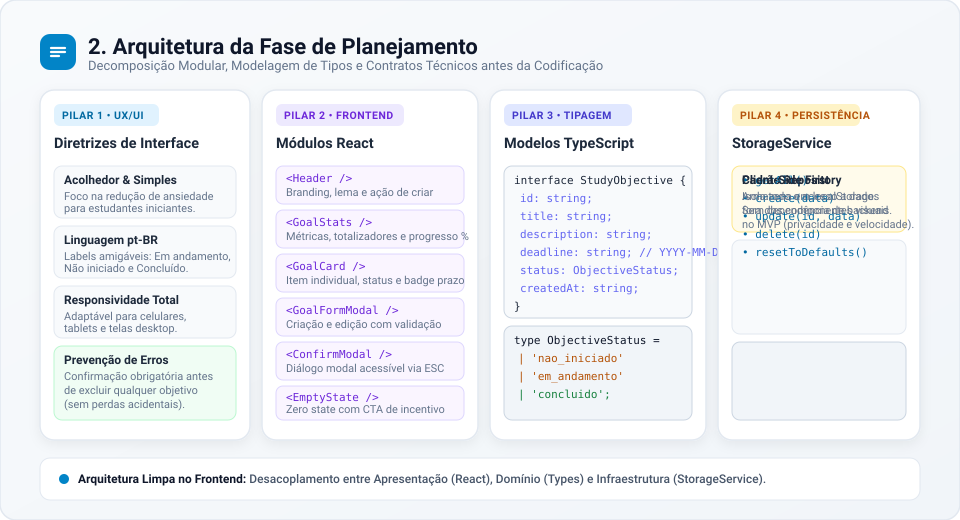

# StudyFlow 🎯 — Gerenciador de Objetivos de Estudo

> **Aplicação desenvolvida durante a Imersão Engenharia de Software com IA: Dev na Era da IA (Google & Alura)**  
> *Uma experiência prática de ponta a ponta: da ideação no Google AI Studio à entrega em arquitetura serverless no Google Cloud Run.*

---

## 📌 Visão Geral do Projeto

O **StudyFlow** é uma aplicação web focada em auxiliar estudantes iniciantes a organizarem seus objetivos de estudo, combaterem a procrastinação e acompanharem sua evolução acadêmica de forma acolhedora, visual e intuitiva.

Diferente do desenvolvimento de software tradicional, o ciclo de vida deste projeto foi concebido e estruturado com o apoio direto de **Inteligência Artificial Generativa (Google AI Studio / Modelos Gemini)** em quatro grandes etapas da engenharia de software:

```
┌─────────────────┐      ┌─────────────────┐      ┌─────────────────┐      ┌─────────────────┐
│ 1. ESPECIFICAÇÃO│ ───► │ 2. PLANEJAMENTO │ ───► │3. IMPLEMENTAÇÃO │ ───► │  4. VALIDAÇÃO   │
└─────────────────┘      └─────────────────┘      └─────────────────┘      └─────────────────┘
```

---

## 🏗️ Arquitetura da Aplicação por Etapas

Abaixo, detalhamos cada uma das 4 etapas fundamentais da arquitetura de software aplicadas ao projeto, acompanhadas de seus respectivos diagramas arquiteturais.

---

### 1. Especificação (Specification & Ideation)

Na etapa de especificação, o foco foi definir com rigor **qual problema resolver** e **para quem resolver**, antes de qualquer linha de código ser escrita.


#### 💡 O Processo de Ideação e Requisitos com IA:
1. **Exploração Conceitual no Playground (Prompt 1)**:
   - **Ambiente:** Google AI Studio (Playground).
   - **Prompt utilizado:**
     > *"Dê uma ideia de aplicativo para ajudar pessoas a estudar."*
   - **Objetivo:** Explorar como a IA em linguagem natural apoia o brainstorming inicial de produto, identificando dores reais de estudantes e mapeando soluções viáveis.
2. **Definição de Requisitos de Produto (Prompt 2)**:
   - **Ambiente:** Google AI Studio (*New App*).
   - **Prompt utilizado:**
     > *"Você é uma pessoa especialista em produtos digitais educacionais. Queremos criar o StudyFlow, uma aplicação simples para ajudar estudantes iniciantes a organizar objetivos de estudo.*  
     > *A primeira versão deve permitir que a pessoa: cadastre, visualize, edite, exclua um objetivo e mantenha seus dados após atualizar a página.*  
     > *Para cada objetivo, considere: título, descrição, prazo e status.*  
     > *Organize a resposta em: 1. problema que o aplicativo resolve; 2. público principal; 3. requisitos funcionais; 4. critérios que podemos utilizar para testar a primeira versão.*  
     > **Não escreva código ainda.**"*
3. **A Regra de Ouro da Engenharia de Software**:
   - A diretiva **"Não escreva código ainda"** garantiu a separação indispensável entre a análise de requisitos de negócio e a solução técnica.
4. **Artefatos Produzidos**:
   - **Problema:** Falta de clareza, desorganização e perda de ritmo de estudantes em início de jornada.
   - **Público-alvo:** Estudantes iniciantes que necessitam de um sistema visual e sem atrito.
   - **Requisitos Funcionais (CRUD):** Criar, listar, atualizar e excluir metas de estudo com persistência local.
   - **Critérios de Aceite:** Roteiro formal que serviu de base para homologar a versão 1.0 (MVP).

---

### 2. Planejamento (Architectural Planning & Design)

Com a especificação consolidada, a etapa de planejamento estruturou as decisões arquiteturais, a decomposição em módulos, a tipagem de dados e a estratégia de armazenamento.



#### 📐 Decisões e Pilares Arquiteturais:
1. **Arquitetura Client-Side First (Sem Backend no MVP)**:
   - **Decisão:** Não utilizar banco de dados relacional ou API backend remota nesta primeira fase.
   - **Justificativa:** Garantir privacidade total ao estudante (os dados pertencem e residem apenas no seu navegador), eliminar custos de infraestrutura e viabilizar funcionamento instantâneo e offline.
2. **Padrão Service / Repository (`StorageService`)**:
   - Toda a responsabilidade de leitura, gravação, validação e desserialização do `window.localStorage` foi isolada no módulo [`storageService.ts`](file:///c:/Users/marco/OneDrive/Documentos/data%20science/code_repo/studyflow-imersao-dev-ai-google-engsoft/src/services/storageService.ts).
   - Componentes visuais não manipulam diretamente a API nativa do navegador, preservando o desacoplamento e facilitando futuras migrações para APIs REST/GraphQL.
3. **Modelagem de Domínio & Tipagem Estrita (TypeScript)**:
   - Localizada em [`src/types/objective.ts`](file:///c:/Users/marco/OneDrive/Documentos/data%20science/code_repo/studyflow-imersao-dev-ai-google-engsoft/src/types/objective.ts):
     - `StudyObjective`: Contrato de dados com `id`, `title`, `description`, `deadline` (formato ISO/YYYY-MM-DD), `status` e `createdAt`.
     - `ObjectiveStatus`: Tipo de união estrito (`'nao_iniciado' | 'em_andamento' | 'concluido'`).
     - `ObjectiveFormData`: Tipagem dedicada para entrada e validação em formulários.
4. **Decomposição em Componentes Modulares**:
   - `<Header />`: Marca, propósito acolhedor e atalho de ação primária (*Novo Objetivo*).
   - `<GoalStats />`: Painel de métricas analíticas (total, andamento, concluídos) e barra de progresso dinâmico em porcentagem.
   - `<GoalCard />`: Cartão individual com cálculo em tempo real de dias até o prazo ou dias de atraso, tags de status e ações rápidas.
   - `<GoalFormModal />`: Modal de formulário com foco e acessibilidade.
   - `<ConfirmModal />`: Modal seguro com bloqueio de exclusões acidentais.
   - `<EmptyState />`: Onboarding visual quando a lista estiver vazia ou nenhum objetivo for encontrado na busca.

---

### 3. Implementação (Implementation & Software Architecture)

A implementação materializou o planejamento através da geração assistida por IA (Prompt 3 no Google AI Studio *New App*), adotando uma stack moderna com React 19, TypeScript e Tailwind CSS v4, empacotada para entrega serverless via Google Cloud Run.


#### 🚀 O Ciclo de Construção (Prompt 3):
- **Prompt utilizado:**
  > *"Crie uma aplicação web chamada StudyFlow para organizar objetivos de estudo.*  
  > *Público: Estudantes iniciantes que precisam organizar o que desejam aprender.*  
  > *A aplicação deve permitir: cadastrar, listar, editar, excluir somente após confirmação, exibir quantidade e salvar no localStorage.*  
  > *Requisitos de interface: visual simples e acolhedor, formulário fácil, cartões, mensagens de estado vazio, responsivo, textos em pt-BR.*  
  > *Requisitos técnicos: usar TypeScript, separar componentes, separar tipos de dados, criar serviço para armazenamento, não utilizar backend nesta primeira versão.*  
  > *Antes de finalizar, confira se todos os requisitos foram implementados."*

#### 🌐 Arquitetura de Runtime e Fluxo de Dados:

```
[ Google Cloud Run (Serviço Serverless no GCP) ]
   │
   │  1. Entrega o código compilado (HTML + React/JS + Tailwind CSS)
   ▼
[ Navegador do Usuário (Computador / Celular do Estudante) ]
   │
   │  2. O React roda localmente na máquina do estudante (SPA)
   │  3. StorageService lê e grava via window.localStorage
   ▼
[ Disco Local do Seu Navegador (localStorage) ]
```

1. **Google Cloud Run (GCP)**: Atua como hospedeiro serverless escalável sob demanda, servindo com altíssima velocidade os assets estáticos gerados pelo Vite (`dist/`).
2. **Navegador do Usuário**: Executa o runtime do React 19 no cliente, gerenciando estados reativos (`useState`, `useEffect`, `useMemo`) e propagando eventos via fluxo de dados unidirecional.
3. **StorageService**: Intermediário síncrono que serializa objetos em JSON e os persiste sob a chave `'studyflow_objectives_v1'`.
4. **Disco Local (localStorage)**: Garante que mesmo sem sinal de internet ou após recarregar o navegador (F5), todos os dados do aluno permaneçam preservados.

#### 📂 Estrutura do Código-Fonte:
```bash
studyflow-imersao-dev-ai-google-engsoft/
├── docs/
│   └── architecture/          # Diagramas de arquitetura em vetor SVG
│       ├── 01-especificacao.svg
│       ├── 02-planejamento.svg
│       ├── 03-implementacao.svg
│       └── 04-validacao.svg
├── src/
│   ├── components/            # Componentes visuais desacoplados
│   │   ├── ConfirmModal.tsx   # Diálogo de confirmação para exclusão segura
│   │   ├── EmptyState.tsx     # Estado vazio e busca sem resultados
│   │   ├── GoalCard.tsx       # Card do objetivo com cálculo de prazos
│   │   ├── GoalFormModal.tsx  # Formulário para criar e editar objetivos
│   │   ├── GoalStats.tsx      # Métricas e barra de progresso percentual
│   │   └── Header.tsx         # Barra superior com branding e CTA
│   ├── services/
│   │   └── storageService.ts  # Camada de abstração do localStorage (CRUD)
│   ├── types/
│   │   └── objective.ts       # Contratos de interfaces e tipos TypeScript
│   ├── App.tsx                # Orquestrador de estado e layout principal
│   ├── index.css              # Configurações globais e Tailwind CSS
│   └── main.tsx               # Ponto de montagem da aplicação React
├── index.html                 # Shell HTML da Single Page Application
├── package.json               # Dependências e scripts do projeto
├── tsconfig.json              # Configurações do compilador TypeScript
└── vite.config.ts             # Configuração de build ultra-rápido com Vite
```

---

### 4. Validação (Validation, Quality & Testing)

A fase de validação fecha o ciclo de engenharia, verificando se cada critério de aceitação definido na Especificação (Prompt 2) e no Planejamento (Prompt 3) foi rigorosamente atendido.


#### 🧪 Matriz de Rastreabilidade e Critérios de Aceitação:

| Requisito / Critério de Aceite | Implementação no StudyFlow | Status |
| :--- | :--- | :---: |
| **Cadastrar objetivo** | Formulário controlado em `<GoalFormModal>` com título, descrição, prazo e status | ✅ Concluído |
| **Visualizar objetivos** | Renderização responsiva em grade via `<GoalCard>` com tags coloridas | ✅ Concluído |
| **Exibir quantidade e métricas** | Painel analítico `<GoalStats>` com contadores e barra de progresso percentual | ✅ Concluído |
| **Editar objetivo** | Modal reutilizado com pré-preenchimento e atualização de dados | ✅ Concluído |
| **Excluir somente após confirmação** | Barreira de segurança em `<ConfirmModal>` evitando perda acidental de metas | ✅ Concluído |
| **Persistência após atualização (F5)** | Leitura e gravação resiliente em `localStorage` via `StorageService` | ✅ Concluído |
| **Mensagem quando não houver objetivos** | Componente `<EmptyState>` acolhedor com CTA para novos cadastros e filtros | ✅ Concluído |
| **Cálculo inteligente de prazos** | Algoritmo em tempo real alertando *"Atrasado há X dias"* ou data formatada | ✅ Concluído |
| **Tipagem estática segura** | Código 100% tipado com TypeScript, garantindo compilação sem erros (`tsc`) | ✅ Concluído |
| **Textos em Português do Brasil** | Interface amigável, acolhedora e totalmente localizada em pt-BR | ✅ Concluído |

#### 🛡️ Resiliência e Prevenção de Falhas:
- **Proteção de Dados Corrompidos:** O `StorageService` implementa blocos `try/catch` que tratam erros na leitura do `localStorage` sem quebrar a aplicação do usuário.
- **Onboarding Automático (Seed Data):** Caso um estudante acesse a aplicação pela primeira vez e seu storage esteja vazio, o sistema injeta automaticamente 3 objetivos de estudo exemplares para orientá-lo sobre como utilizar a plataforma.
- **Teclas de Atalho & Acessibilidade:** O modal de confirmação escuta o evento global da tecla `Escape` (`ESC`), garantindo fechamento rápido e ergonômico.

---

## 🛠️ Tecnologias Utilizadas

- **Frontend Core:** [React 19](https://react.dev/)
- **Linguagem:** [TypeScript](https://www.typescriptlang.org/)
- **Build Tool & Bundler:** [Vite](https://vitejs.dev/)
- **Estilização & Design System:** [Tailwind CSS v4](https://tailwindcss.com/)
- **Ícones Modernos:** [Lucide React](https://lucide.dev/)
- **Inteligência Artificial:** [Google AI Studio](https://aistudio.google.com/) (Gemini Flash & Pro)
- **Hospedagem & Infraestrutura:** [Google Cloud Run](https://cloud.google.com/run) (Serverless Container)

---

## 💻 Como Executar o Projeto Localmente

### Pré-requisitos
- [Node.js](https://nodejs.org/) (versão 18 ou superior)
- Gerenciador de pacotes `npm` ou `pnpm`

### Passo a Passo

1. **Clone o repositório:**
   ```bash
   git clone https://github.com/mordonha/StudyFlow---APP.git
   cd studyflow-imersao-dev-ai-google-engsoft
   ```

2. **Instale as dependências:**
   ```bash
   npm install
   ```

3. **Inicie o servidor de desenvolvimento:**
   ```bash
   npm run dev
   ```
   A aplicação estará disponível em `http://localhost:3000`.

4. **Para verificar os tipos TypeScript:**
   ```bash
   npm run lint
   ```

5. **Para gerar a versão de produção:**
   ```bash
   npm run build
   ```

---

## 🎓 Créditos e Agradecimentos

Este projeto foi construído durante a **Imersão Engenharia de Software com IA: Dev na Era da IA**, promovida pela **Alura** em parceria com o **Google**.

---

<div align="center">
  <sub>Desenvolvido com foco, disciplina e Inteligência Artificial. StudyFlow © 2026.</sub>
</div>
