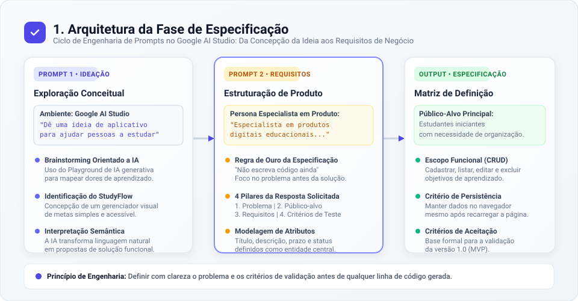
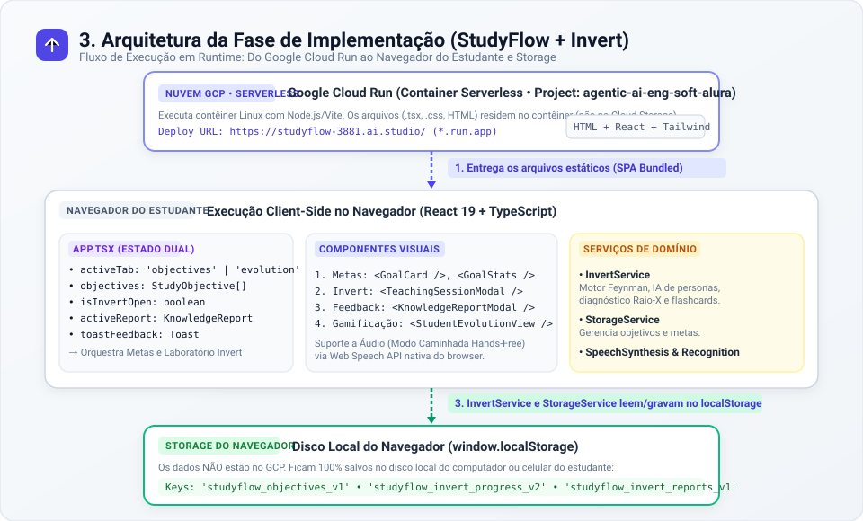
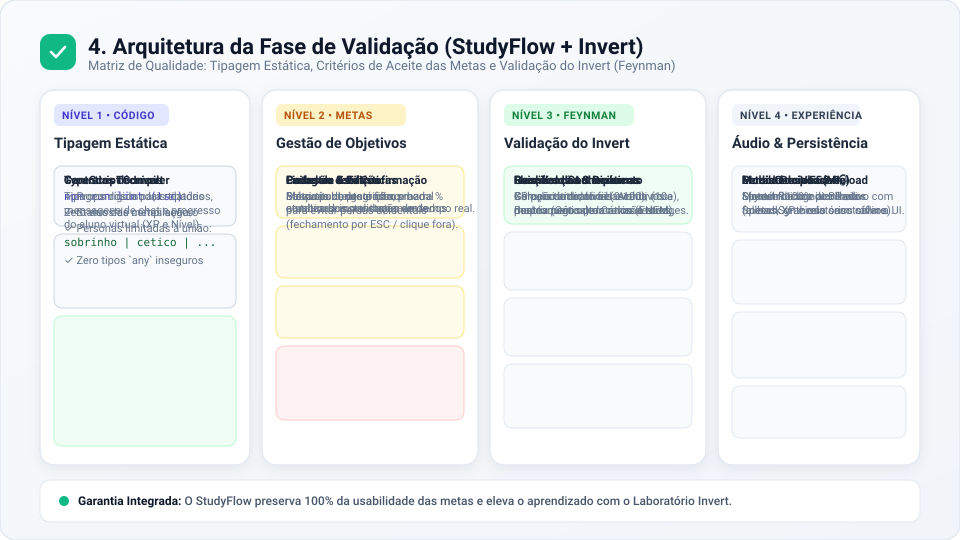

# StudyFlow 🎯 — Gerenciador de Objetivos de Estudo & Laboratório Invert ("Aprenda Ensinando")

> **Aplicação desenvolvida e evoluída durante a Imersão Engenharia de Software com IA: Dev na Era da IA (Google & Alura)**  
> *Uma experiência prática de ponta a ponta: da ideação com neurociência no Google AI Studio à entrega em arquitetura serverless no Google Cloud Run.*

---

## 🎓 Apresentação do Projeto & Contexto Educacional

> [!NOTE]
> **PROJETO ORIENTADO AO APRENDIZADO**  
> Este projeto foi concebido e implementado estritamente como um **exercício prático de aprendizado** durante a **Imersão em Engenharia de Software com IA**, promovida pela **ALURA** em parceria com o **Google**.

O objetivo primordial desta aplicação é exercitar as competências centrais da moderna Engenharia de Software potencializada por Inteligência Artificial Generativa. Ao longo da imersão, exploramos como os modelos fundacionais de IA (como a família **Gemini**) transformam as etapas essenciais do ciclo de vida de desenvolvimento de software (SDLC):

1. **Exploração e Ideação:** Como formular perguntas abertas para descobrir oportunidades e produtos no *Google AI Studio Playground*.
2. **Engenharia de Requisitos:** Como utilizar a persona de especialista em produto para elicitar requisitos funcionais, não funcionais e critérios de teste, aplicando o princípio de **"Não escreva código ainda"**.
3. **Modelagem & Arquitetura Limpa:** Decomposição modular em componentes React, tipagem rígida com TypeScript e isolamento de persistência através do padrão Service.
4. **Implementação & Geração Assistida:** Construção da Single Page Application com React 19, TypeScript e Tailwind CSS v4.
5. **Entrega Serverless em Nuvem:** Publicação na infraestrutura gerenciada do **Google Cloud Platform (GCP)** com **Google Cloud Run**.

🔗 **Ambiente em Produção (Google AI Studio / Cloud Run):**  
👉 **[https://studyflow-3881.ai.studio/](https://studyflow-3881.ai.studio/)**

---

## 🧠 A Grande Inovação: Invert ("Aprenda Ensinando")

Nesta nova versão desenvolvida na branch `StudyFlow-Invert-App`, o **StudyFlow** foi refatorado e expandido para integrar um método inovador de estudo baseado em **neurociência e Inteligência Artificial**, fundamentado na famosa **Técnica Feynman**.

### O Conceito Central:
> *"A melhor forma de aprender algo é tentando explicar esse assunto de forma simples para outra pessoa."* — Richard Feynman

No **Invert**, a dinâmica tradicional de estudos é invertida: **você não é o aluno, você é o professor**. O aplicativo coloca uma Inteligência Artificial no papel de um **"aluno curioso"** que você precisa ensinar.

```
┌────────────────────────────────────────────────────────────────────────┐
│                        DINÂMICA TRADICIONAL                            │
│  Professor / Livro / IA   ──────────────►  Você (Estudante Passivo)    │
│  (Cria a "Ilusão de Competência": parece fácil quando os outros falam) │
└────────────────────────────────────────────────────────────────────────┘
                                    ▼
┌────────────────────────────────────────────────────────────────────────┐
│                      DINÂMICA INVERT (FEYNMAN)                         │
│  Você (Professor Ativo)   ──────────────►  Aluno IA Curioso (Dúvidas)  │
│  (Força Recuperação Ativa, Identifica Lacunas e Gera Memória de Longo) │
└────────────────────────────────────────────────────────────────────────┘
```

### Como Funciona na Prática:
1. **Escolha o Tema:** Você pode ensinar um dos seus objetivos cadastrados no StudyFlow (com 1 clique no botão *"Ensinar (Feynman)"*) ou digitar qualquer assunto livre (ex: *Estruturas de Dados, Fotossíntese, Segunda Guerra, Cálculo*).
2. **Escolha o Perfil do seu "Aluno IA":**
   - 👦 **Arthur (O Sobrinho de 10 anos):** Não conhece jargões. Obriga você a usar analogias e metáforas do dia a dia (peças de Lego, regras de trânsito, brinquedos).
   - 🧐 **Beatriz (A Colega Cética):** Questiona suas fontes, aponta contradições e pede provas: *"Mas por que exatamente isso acontece?"*.
   - 🎯 **Carlos (O Aluno Pré-Vestibular / Concurseiro):** Focado em pegadinhas de bancas, detalhes técnicos de prova e fórmulas.
3. **A Sessão de Ensino (Voz ou Texto):** Você explica o conteúdo com suas próprias palavras, podendo digitar ou ditar por áudio através do microfone integrado.
4. **O Teste de Compreensão da IA:** A IA responde com dúvidas genuínas em caráter da persona, aponta o que compreendeu e faz perguntas sobre trechos vagos.
5. **O "Raio-X do Conhecimento" (Feedback Diagnóstico):** Ao finalizar a aula, a IA gera um relatório cirúrgico:
   - 🌟 **O que você domina:** Conceitos explicados com clareza e precisão.
   - 🔍 **Pontos Cegos:** Detalhes importantes do conteúdo que você esqueceu de mencionar.
   - ⚠️ **Erros Conceituais:** Equívocos ou afirmações categóricas sem fundamentação.
   - 📊 **Nota de Didática (0 a 100):** Avaliação objetiva da clareza da explicação.
6. **Recursos Extras Implementados:**
   - 🎧 **Modo Caminhada (100% Hands-Free):** O aplicativo fala as dúvidas do aluno em voz alta utilizando a *Web Speech API (SpeechSynthesis)* nativa, permitindo que o usuário estude e explique enquanto caminha ou realiza outras tarefas.
   - 🏆 **Gamificação ("Evolua seu Aluno"):** Seu aluno virtual começa como *"Leigo Curioso"* e ganha XP a cada aula bem explicada, subindo de nível (*Aprendiz, Estudante Aplicado, Pensador Crítico, Mestre*) e desbloqueando diplomas acadêmicos!
   - 🗂️ **Geração Automática de Revisão (Flashcards):** Criação instantânea de cartões de recuperação ativa com perguntas focadas exatamente nas lacunas e pontos cegos identificados no Raio-X.

---

## 🏗️ Arquitetura da Aplicação por Etapas

Abaixo, detalhamos como a arquitetura do **StudyFlow + Invert** foi concebida nas 4 etapas fundamentais da Engenharia de Software.

---

### 1. Especificação (Specification & Ideation)

A especificação evoluiu para integrar a neurociência cognitiva e o aprendizado ativo ao gerenciamento de metas.



#### 💡 Os Pilares da Especificação:
1. **Combate à Ilusão de Competência:** Leitura e consumo passivo de vídeo-aulas geram uma falsa percepção de domínio. A exigência de verbalizar ou redigir a explicação força a **recuperação ativa** (*active recall*), consolidando a sinapse de longo prazo.
2. **Engenharia de Prompt para Alunos Virtuais:** Em vez de usar a IA como oráculo que dá respostas prontas (diminuindo o esforço cognitivo do aluno), a IA foi especificada como um **agente questionador** que estimula o raciocínio crítico do usuário.
3. **Elicitação das 3 Personas:** Definidas regras de comportamento rigorosas para cada perfil:
   - *Sobrinho:* Vetar jargões e disparar alertas infantis ao encontrar termos acadêmicos.
   - *Cética:* Exigir relação de causalidade e provas lógicas.
   - *Vestibulando:* Cobrar pegadinhas, exceções e termos técnicos de prova.
4. **Preservação de Escopo:** Manter 100% da usabilidade existente do gerenciador de metas do StudyFlow (CRUD, prazos, cálculo de atrasos, estatísticas de progresso e persistência local).

---

### 2. Planejamento (Architectural Planning & Design)

O planejamento estruturou o sistema em módulos independentes, desacoplando o Laboratório Invert do motor de metas.


#### 📐 Módulos e Contratos Técnicos:
1. **Camada de Apresentação (UI / UX):**
   - `<Header />`: Navegação por abas (*Metas & Prazos* vs. *Evolução do Aluno IA*) e gatilho global de ensino.
   - `<TeachingSessionModal />`: Sala de aula interativa com transcrição de chat, botão de voz e botão para alternar o *Modo Caminhada*.
   - `<PersonaSelector />`: Grid seletor de alunos com badges de foco mental.
   - `<KnowledgeReportModal />`: Modal visual do Raio-X do Conhecimento com flip cards interativos de revisão ativa.
   - `<StudentEvolutionView />`: Painel de gamificação com barra de XP, nível atual e vitrine de diplomas.
   - `<GoalCard />`: Cartão de objetivo aprimorado com atalho direto 💡 *"Ensinar (Feynman)"*.
2. **Modelagem de Domínio & Tipos TypeScript (`src/types/invert.ts`):**
   - `StudentPersonaId`: `'sobrinho' | 'cetico' | 'vestibulando'`
   - `TeachingMessage`: Representação de turnos de diálogo com emissor (`'user' | 'ai'`) e timestamp.
   - `KnowledgeReport`: Entidade imutável com pontuação, domínio, pontos cegos, erros e flashcards.
   - `VirtualStudentProgress`: Estado de gamificação com nível, XP atual e diplomas desbloqueados.
3. **Camada de Serviços (`src/services/invertService.ts`):**
   - Isolamento das regras de gamificação, motor de geração de réplicas da IA e integração com as APIs de voz do navegador (`SpeechSynthesis` e `SpeechRecognition`).

---

### 3. Implementação (Implementation & Software Architecture)

A implementação estendeu o código-fonte com TypeScript estrito, garantindo reatividade de estado limpa e persistência no cliente.



#### 🌐 Arquitetura de Runtime e Fluxo de Dados:

```
[ Google Cloud Run (Serviço Serverless no GCP) ]
   │
   │  1. Entrega o código compilado (HTML + React 19 + JS Bundled + Tailwind CSS)
   ▼
[ Navegador do Usuário (Computador / Celular do Estudante) ]
   │
   │  2. O React roda localmente na máquina do estudante (SPA)
   │  3. InvertService e StorageService leem e gravam via window.localStorage
   ▼
[ Disco Local do Seu Navegador (localStorage) ]
   - 'studyflow_objectives_v1'       (Metas e prazos)
   - 'studyflow_invert_progress_v2'  (Nível, XP e diplomas do aluno)
   - 'studyflow_invert_reports_v1'   (Histórico de Raio-X e flashcards)
```

---

### 3.1 Infraestrutura Serverless no GCP & Arquitetura de Deploy

A aplicação StudyFlow foi concebida e publicada na infraestrutura do **Google Cloud Platform (GCP)** através da integração nativa com o **Google AI Studio** ([https://studyflow-3881.ai.studio/](https://studyflow-3881.ai.studio/)), associada ao projeto GCP da imersão:
- **Projeto Google Cloud (Project ID):** `agentic-ai-eng-soft-alura`
- **Ambiente de Hospedagem:** Google Cloud Run (Serverless Container Platform)
- **Domínio Ativo:** `https://studyflow-3881.ai.studio/` (roteado para instâncias `*.run.app`)

#### 1. Como a aplicação é servida (O papel do Google Cloud Run)
- **URL gerenciada pelo Cloud Run (`*.run.app`):** O Cloud Run é o serviço serverless do Google Cloud Platform que gerencia contêineres sem necessidade de provisionar ou gerenciar servidores físicos. Ele escala sob demanda (inclusive para 0 instâncias quando não há requisições, eliminando custos ociosos).
- **Os arquivos estão armazenados no Cloud Storage?**  
  **Não diretamente como um site estático do Cloud Storage.**  
  O Cloud Run executa um contêiner Linux leve contendo Node.js e o runtime do Vite/Express. Os arquivos compilados do projeto (`.tsx`, `.css`, `index.html`) residem diretamente dentro do sistema de arquivos virtual desse contêiner virtual.  
  Quando você acessa a URL, o Cloud Run processa a requisição HTTP e entrega o pacote frontend (HTML, JavaScript compilado e Tailwind CSS) para o navegador do estudante, onde o React assume o controle da interface.

#### 2. Onde ficam os objetivos de estudo e aulas que você cadastra? (Isolamento de Dados)
> [!IMPORTANT]
> **Os dados NÃO estão no Google Cloud Platform (GCP).**  
> Nesta versão da aplicação, os objetivos de estudo, as aulas ministradas e o progresso do aluno IA:
> - ❌ **Não vão para o Cloud Run;**
> - ❌ **Não vão para o Cloud Storage;**
> - ❌ **Não vão para nenhum banco de dados em nuvem** (como Cloud Firestore, Cloud SQL ou Bigtable).

**Eles ficam armazenados exclusivamente no `localStorage` do seu navegador:**
- O `localStorage` é uma memória interna e persistente do próprio navegador web (armazenamento local gravado no disco físico do computador ou celular do estudante).
- **Por que os dados continuam lá após o F5?**  
  Se você atualizar a página (F5 ou recarregar), os dados permanecem visíveis porque o navegador lê diretamente do disco da sua própria máquina via `StorageService` e `InvertService`.
- **Por que os dados não aparecem em outro dispositivo?**  
  Se você abrir a mesma URL no celular, em outro navegador (exemplo: Mozilla Firefox em vez do Google Chrome) ou em uma aba anônima, os objetivos não estarão lá. O `localStorage` é estritamente isolado por dispositivo, navegador e domínio de navegação.

#### 3. Como realizar o Deploy dentro do Google Cloud Platform (GCP)

Baseado na arquitetura serverless concebida junto ao **Google AI Studio**, o deploy pode ser realizado por duas vias:

##### Via A: Deploy Integrado via Google AI Studio (Fluxo Oficial do Estudo)
1. No ambiente do **Google AI Studio** (`https://studyflow-3881.ai.studio/`), acesse a aplicação construída via *New App*.
2. O ambiente AI Studio já se conecta ao projeto GCP configurado (`agentic-ai-eng-soft-alura`).
3. Ao acionar o botão de deploy, a plataforma executa o build dos arquivos Vite/TypeScript, empacota a imagem de contêiner serverless e a publica diretamente no Google Cloud Run, gerando a URL segura HTTPS pública.

##### Via B: Deploy Manual / CI-CD utilizando o Google Cloud SDK (`gcloud CLI`)
Caso deseje realizar o deploy a partir do código-fonte local utilizando o SDK oficial do Google Cloud:

1. **Autenticar na sua conta Google:**
   ```bash
   gcloud auth login
   ```

2. **Definir o projeto GCP ativo:**
   ```bash
   gcloud config set project agentic-ai-eng-soft-alura
   ```

3. **Habilitar as APIs necessárias no projeto GCP:**
   ```bash
   gcloud services enable run.googleapis.com cloudbuild.googleapis.com artifactregistry.googleapis.com
   ```

4. **Executar o build e deploy no Cloud Run:**
   ```bash
   gcloud run deploy studyflow \
     --source . \
     --region us-central1 \
     --platform managed \
     --allow-unauthenticated \
     --port 3000
   ```
   *Explicação:* O Google Cloud Run aciona o Cloud Build sob o capô, utilizando Buildpacks para identificar o projeto Node.js/Vite, compilar os assets estáticos e expor o serviço em porta gerenciada com certificado TLS/SSL automático.

---

#### 📂 Estrutura do Código-Fonte Atualizada:
```bash
studyflow-imersao-dev-ai-google-engsoft/
├── docs/
│   └── architecture/               # Diagramas em vetor SVG (atualizados)
│       ├── 01-especificacao.svg
│       ├── 02-planejamento.svg
│       ├── 03-implementacao.svg
│       └── 04-validacao.svg
├── src/
│   ├── components/
│   │   ├── invert/                 # Novo Subsistema: Laboratório Feynman
│   │   │   ├── KnowledgeReportModal.tsx # Raio-X do Conhecimento & Flashcards
│   │   │   ├── PersonaSelector.tsx      # Seletor das 3 Personas de Alunos IA
│   │   │   ├── StudentEvolutionView.tsx # Gamificação, Níveis e Diplomas
│   │   │   └── TeachingSessionModal.tsx # Sala de Aula Interativa (Voz & Texto)
│   │   ├── ConfirmModal.tsx        # Confirmação de exclusão segura
│   │   ├── EmptyState.tsx          # Estados vazios e onboarding
│   │   ├── GoalCard.tsx            # Card com cálculo de prazos + botão Invert
│   │   ├── GoalFormModal.tsx       # Formulário de metas
│   │   ├── GoalStats.tsx           # Painel de métricas e barra de progresso
│   │   └── Header.tsx              # Barra superior com abas de navegação
│   ├── services/
│   │   ├── invertService.ts        # Motor de IA Feynman, Gamificação e Áudio
│   │   └── storageService.ts       # Repositório de objetivos no localStorage
│   ├── types/
│   │   ├── invert.ts               # Tipos do Laboratório Invert
│   │   └── objective.ts            # Tipos dos Objetivos de Estudo
│   ├── App.tsx                     # Orquestrador mestre de estado
│   ├── index.css                   # Tailwind CSS v4
│   └── main.tsx                    # Ponto de entrada React 19
├── index.html                      # Shell da aplicação
├── package.json                    # Dependências (@google/genai, lucide, react 19)
├── tsconfig.json                   # Compilador TypeScript
└── vite.config.ts                  # Bundler Vite
```

---

### 4. Validação (Validation, Quality & Testing)

A validação assegura a qualidade da experiência do usuário em todas as frentes:



#### 🧪 Matriz de Rastreabilidade e Critérios de Aceitação:

| Requisito / Critério de Aceite | Implementação no StudyFlow | Status |
| :--- | :--- | :---: |
| **Cadastrar, listar e editar objetivos** | Formulário controlado e grid responsiva com badges de prazos e cálculo de atraso | ✅ Concluído |
| **Exclusão segura com confirmação** | Modal `<ConfirmModal>` acessível via teclado (`ESC`) e clique externo | ✅ Concluído |
| **Persistência total pós-F5** | `localStorage` guarda metas, histórico de aulas e progresso do aluno virtual | ✅ Concluído |
| **Inversão de papéis (Técnica Feynman)** | O usuário ensina e o aluno IA formula dúvidas e questionamentos genuínos | ✅ Concluído |
| **3 Personas com desafios cognitivos** | Arthur (sem jargões), Beatriz (cética/provas) e Carlos (técnico/ENEM) | ✅ Concluído |
| **Raio-X do Conhecimento** | Diagnóstico com nota de clareza (0-100), domínio, pontos cegos e erros conceituais | ✅ Concluído |
| **Geração automática de flashcards** | Cartões interativos de revisão ativa criados com base nas lacunas detectadas | ✅ Concluído |
| **Modo Caminhada (Hands-Free)** | Leitura das dúvidas do aluno em voz alta com a API `SpeechSynthesis` | ✅ Concluído |
| **Entrada por Voz e Áudio** | Microfone integrado com `SpeechRecognition` nativo do navegador | ✅ Concluído |
| **Gamificação ("Evolua seu Aluno")** | Sistema de XP cumulativo, níveis evolutivos e diplomas desbloqueados | ✅ Concluído |
| **Tipagem estática segura** | Código 100% tipado com TypeScript, sem tipos `any` inseguros | ✅ Concluído |

---

## 🛠️ Tecnologias Utilizadas

- **Frontend Core:** [React 19](https://react.dev/)
- **Linguagem:** [TypeScript](https://www.typescriptlang.org/)
- **Build Tool & Bundler:** [Vite](https://vitejs.dev/)
- **Estilização & Design System:** [Tailwind CSS v4](https://tailwindcss.com/)
- **Ícones Modernos:** [Lucide React](https://lucide.dev/)
- **APIs Nativas do Navegador:** Web Speech API (`SpeechRecognition` e `SpeechSynthesis`), `window.localStorage`
- **Inteligência Artificial:** [Google AI Studio](https://aistudio.google.com/) (Gemini Models & Prompt Engineering)
- **Hospedagem & Infraestrutura:** [Google Cloud Run](https://cloud.google.com/run) (Serverless Container Platform)
- **Projeto Google Cloud:** `agentic-ai-eng-soft-alura`

---

## 💻 Como Executar o Projeto Localmente

### Pré-requisitos
- [Node.js](https://nodejs.org/) (versão 18 ou superior)
- Gerenciador de pacotes `npm` ou `pnpm`

### Passo a Passo

1. **Clone o repositório e acesse a branch da nova feature:**
   ```bash
   git clone https://github.com/mordonha/StudyFlow---APP.git
   cd studyflow-imersao-dev-ai-google-engsoft
   git checkout StudyFlow-Invert-App
   ```

2. **Instale as dependências:**
   ```bash
   npm install
   ```

3. **Inicie o servidor de desenvolvimento:**
   ```bash
   npm run dev
   ```
   A aplicação estará disponível em `http://localhost:3000`.

4. **Para verificar os tipos TypeScript:**
   ```bash
   npm run lint
   ```

5. **Para gerar a versão de produção:**
   ```bash
   npm run build
   ```

---

## 🚀 Próximos Passos: Cenário para Merge das Branches e Deploy no GCP (Google Cloud SDK)

> [!IMPORTANT]
> **Cenário de Orientações Futuras:** Conforme solicitado, as novas features foram desenvolvidas e isoladas nesta branch (`StudyFlow-Invert-App`). O merge e o deploy não foram executados agora. Quando estiver pronto para unificar com a branch `main` e atualizar a produção no Google Cloud, execute os passos abaixo.

### Passo 1: Merge da Branch `StudyFlow-Invert-App` para a `main`

No terminal da sua máquina:
```bash
# 1. Certifique-se de que todas as alterações na branch da feature foram commitadas
git status

# 2. Retorne para a branch principal
git checkout main

# 3. Puxe as atualizações mais recentes do repositório remoto
git pull origin main

# 4. Realize o merge das novas features do Invert na branch principal
git merge StudyFlow-Invert-App -m "merge: incorpora features do Laboratorio Invert (Aprenda Ensinando) na main"

# 5. Envie a branch main atualizada para o GitHub
git push origin main
```

---

### Passo 2: Deploy no Google Cloud Platform via Google Cloud SDK (`gcloud CLI`)

Com o Google Cloud SDK instalado em sua máquina:

1. **Autenticar no GCP com sua conta Google:**
   ```bash
   gcloud auth login
   ```

2. **Definir o projeto oficial da imersão como ativo:**
   ```bash
   gcloud config set project agentic-ai-eng-soft-alura
   ```

3. **Verificar se as APIs de nuvem estão ativas:**
   ```bash
   gcloud services enable run.googleapis.com cloudbuild.googleapis.com artifactregistry.googleapis.com
   ```

4. **Executar o build e deploy direto no Google Cloud Run:**
   ```bash
   gcloud run deploy studyflow \
     --source . \
     --region us-central1 \
     --platform managed \
     --allow-unauthenticated \
     --port 3000
   ```
   *O que acontecerá no GCP:*
   - O Cloud Run invocará o **Cloud Build**, que compilará a aplicação Vite/React 19 em uma imagem de contêiner segura.
   - O contêiner será implantado no Cloud Run com escalabilidade automática (0 a N instâncias).
   - O console retornará a URL oficial HTTPS (`https://studyflow-*.run.app`) pronta para uso público!

---

## 🎓 Créditos e Agradecimentos

Este projeto foi construído e expandido durante a **Imersão Engenharia de Software com IA: Dev na Era da IA**, promovida pela **Alura** em parceria com o **Google**.

---

<div align="center">
  <sub>Desenvolvido com foco, didática e Inteligência Artificial. StudyFlow + Invert © 2026.</sub>
</div>
